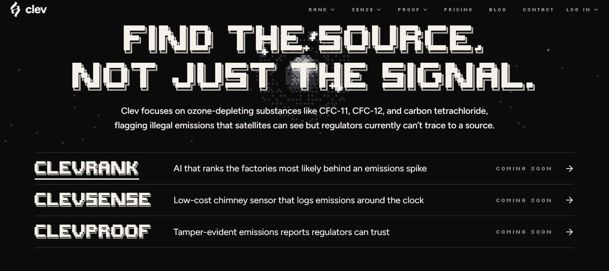

Hi, I’m Brook Yirsaw. I study Electrical and Computer Engineering at Addis Ababa University.

I build web interfaces and tutor math on Preply, where I’ve taught 100+ lessons.

When I explain a signal, I like to let people move it around and see what changes. That’s the idea behind my convolution visualizer.

## Featured projects

### [Tsex Icons](https://github.com/brook-hub7777/Tsex-icons)

A React SVG icon library with linear, bold, and bulk variants. Tree-shaking lets your bundler leave out icons you don’t use.

### [Apex](https://github.com/brook-hub7777/apexx)

A privacy-first study workspace that turns your learning materials into practice.

### [Clev](https://github.com/brook-hub7777/clevv)

AI-assisted plume modeling and sensor data to help pinpoint illegal ozone-depleting emissions.

## What I work with

**Languages**  
  

**Web and graphics**  
   

**Engineering** · MATLAB · signal processing · control systems
