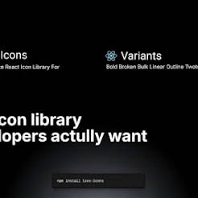
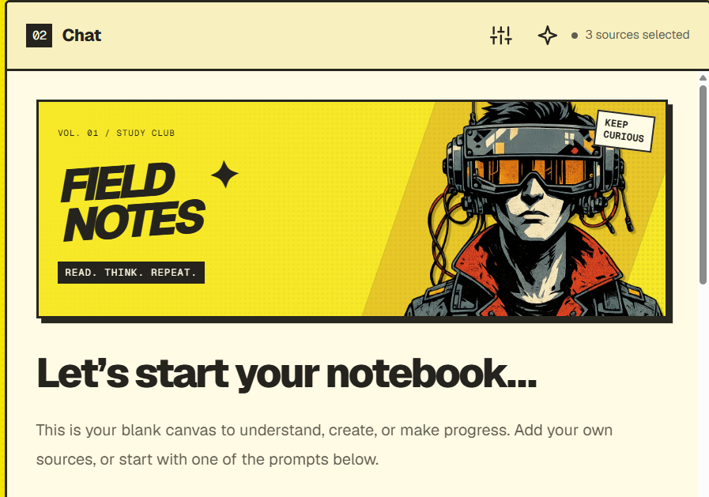

Hi, I’m Brook Yirsaw. I study Electrical and Computer Engineering at Addis Ababa University.

I build web interfaces and tutor math on Preply, where I’ve taught 100+ lessons.

When I explain a signal, I like to let people move it around and see what changes. That’s the idea behind my convolution visualizer.

## Featured projects

Jump to [Tsex Icons](#tsex-icons), [Apex](#apex), or [Clev](#clev).

<table width="100%">
  <tr>
    <td width="50%" valign="top">
      
      <h3><a href="https://github.com/brook-hub7777/Tsex-icons">Tsex Icons</a></h3>
      
A React SVG icon library with linear, bold, and bulk variants. Tree-shaking lets your bundler leave out icons you don’t use.

      
    </td>
    <td width="50%" valign="top">
      
      <h3><a href="https://github.com/brook-hub7777/apexx">Apex</a></h3>
      
A privacy-first study workspace where you can start a notebook with your own sources and turn them into practice.

      
    </td>
  </tr>
  <tr>
    <td valign="top">
      
      <h3><a href="https://github.com/brook-hub7777/clevv">Clev</a></h3>
      
Clev combines AI-assisted plume modeling with sensor data to help trace illegal emissions of ozone-depleting substances back to their source.

      
    </td>
    <td></td>
  </tr>
</table>

## What I work with

- **Languages** · JavaScript, Python, Java
- **Web and graphics** · React, Tailwind CSS, Three.js, Vite
- **Engineering** · MATLAB, signal processing, control systems
